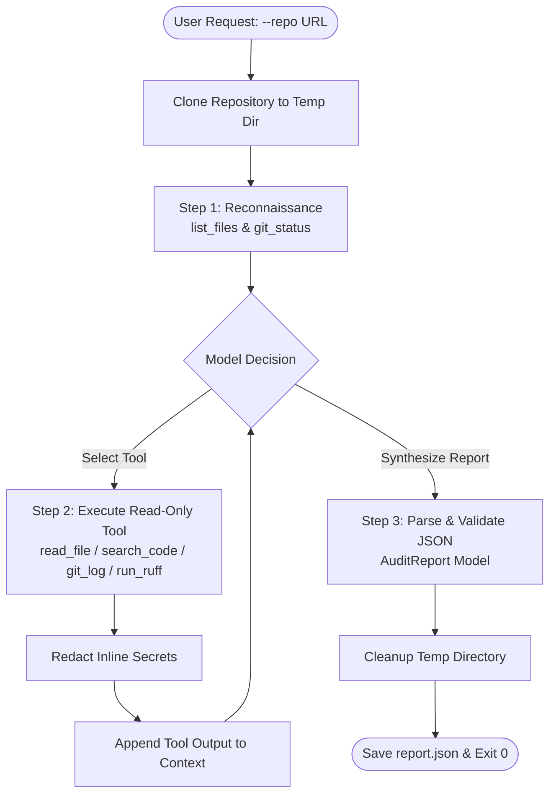

# Autonomous DevOps Repository Auditing Agent

An autonomous, pure-Python auditing agent that inspects GitHub repositories for DevOps best practices, CI/CD reliability, repository hygiene, static code quality, and security vulnerabilities.

Built without external agent frameworks (zero LangChain or LangGraph dependencies) using the high-speed **Cerebras Cloud SDK** and **Pydantic v2**.

---

## Key Features

- **Pure Python Architecture**: Custom multi-turn tool-calling loop with zero framework bloat.
- **Deep DevOps Inspection**: Evaluates 9 core areas covering repository hygiene, dependencies, CI/CD, security, testing, and configurations.
- **Sandboxed Read-Only Tooling**:
  - `clone_repo`: Isolated shallow clone with automated cleanup.
  - `list_files`: Comprehensive directory discovery with internal tool filtering (`.venv`, `node_modules`).
  - `read_file`: Line-numbered, sliced file inspection with path traversal protection.
  - `search_code`: Fast regular expression scanning across text files.
  - `git_log` & `git_status`: Commit traceability and Git index tracking verification.
  - `run_ruff`: Non-executing static code analysis via Ruff.
- **Zero Secret Leakage**: Multi-layered regex masking for passwords, API keys, tokens (`ghp_`, `sk-`, `AKIA`), and PEM private keys.
- **Anti-False-Positive Engine**: Aware of equivalent modern configurations (`pyproject.toml`, `Pipfile`) with strict zero-hallucination ground truth verification.
- **Structured JSON Contract**: Outputs validated, deduplicated findings strictly conforming to the `AuditReport` schema.

---

## Architecture & Agent Operational Cycle

The agent operates in a continuous observation-reasoning loop:



### Operational Steps

1. **Observe**: Inspect repository layout, committed files, and Git tracking status.
2. **Reason**: Analyze dependencies, workflow configurations, scripts, and potential defects.
3. **Select Tool**: Dynamically query specific files, search for patterns, or run static analysis.
4. **Execute Tool**: Run safely with path traversal guards and execution timeouts.
5. **Interpret Results**: Ingest redacted outputs back into conversation history.
6. **Report**: Emit a deduplicated, schema-validated JSON report and terminate.

---

## The 9 DevOps Inspection Areas

| Category | Rule Prefix | Scope & Checks |
|---|---|---|
| `repository_hygiene` | `HYG-001`+ | Missing README, missing `.gitignore`, committed caches (`__pycache__/`, `.DS_Store`, `.env`, logs). |
| `dependency_management` | `DEP-001`+ | Unpinned packages, bare dependency names, conflicting manifests. |
| `code_quality` | `QUAL-001`+ | Missing linter configuration, static analysis errors from `run_ruff`. |
| `testing` | `TEST-001`+ | Complete absence of test suite, empty tests, tests not invoked in CI. |
| `github_actions_ci` | `CI-001`+ | Missing CI workflows, `continue-on-error: true`, unpinned action tags (`@main`). |
| `security` | `SEC-001`+ | Hardcoded credentials/keys, `write-all` permissions, unsafe `pull_request_target`. |
| `configuration` | `CFG-001`+ | Machine-specific paths (`/Users/...`, `C:\...`), committed `.env`, `DEBUG=True`. |
| `collaboration` | `COL-001`+ | Unsafe automated PR merging without review or required status gates. |
| `build_and_release` | `BLD-001`+ | Deployment workflows without upstream build or test verification gates. |

---

## Prerequisites & Installation

- **Python**: Version 3.10 or higher.
- **Git**: Installed and available in your system path.

### 1. Create and Activate Virtual Environment

**Windows (PowerShell):**
```powershell
python -m venv .venv
.venv\Scripts\Activate.ps1
```

**macOS / Linux:**
```bash
python3 -m venv .venv
source .venv/bin/activate
```

### 2. Install Dependencies

```bash
pip install -r requirements.txt
```

---

## Configuration

Copy the example environment configuration and supply your Cerebras API key:

```bash
cp .env.example .env
```

Edit `.env`:
```env
CEREBRAS_API_KEY=your_actual_cerebras_api_key_here
CEREBRAS_MODEL=qwen-3.8-27b
```

---

## Usage

Run the auditor against any public HTTP/HTTPS GitHub repository:

```bash
python agent.py --repo https://github.com/example/demo-project --output report.json
```

### CLI Arguments

| Argument | Required | Default | Description |
|---|---|---|---|
| `--repo` | **Yes** | — | Target GitHub repository URL (`https://github.com/owner/repo`). |
| `--output` | No | `report.json` | Destination path for the generated JSON report. |
| `--max-turns` | No | `15` | Maximum conversation turns before forcing final report synthesis. |
| `--quiet` | No | `False` | Suppress live turn-by-turn agent progress output. |

---

## Output Format

The generated report adheres strictly to the [`AuditReport`](schemas.py) JSON schema:

```json
{
  "repository": "https://github.com/example/demo-project",
  "violations": [
    {
      "rule_id": "SEC-001",
      "category": "security",
      "severity": "critical",
      "file": "config.py",
      "line": 12,
      "description": "Hardcoded secret API key committed in configuration file.",
      "evidence": "API_KEY = \"[REDACTED]\"",
      "recommendation": "Remove hardcoded secret from repository history and load from environment variables."
    }
  ]
}
```

---

## Running Automated Tests

Run the full pytest suite with verbose output:

```bash
pytest -v
```

Run code formatting and static analysis checks:

```bash
ruff check .
```
